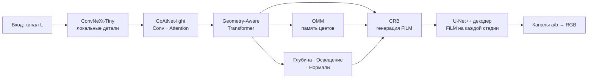

<!--
  Как добавить новый проект: скопируй любую строку в таблице «Ещё проекты» и поменяй название, тип, описание и ссылки.
  Как убрать плейсхолдер: строки Luma и qscan — допиши описание и ссылку на Google Play (см. комментарии рядом).
-->

 

 

Делаю инструменты, которые решают конкретную задачу.

---

## Избранное

<table>
<tr>
<td width="33%" valign="top">

### 🔥 FlameBlock

Блокировщик рекламы, трекеров и анти-адблок заглушек для Chrome и Opera. Стелс-режим против попандеров, защита от отпечатка браузера (Canvas, WebGL, Audio) и от утечки IP через WebRTC. Всё работает локально, данные не собираются. 12 языков интерфейса.

`Manifest V3` `declarativeNetRequest` `JavaScript`

[Chrome Web Store](https://chromewebstore.google.com/detail/bodhfehapbebidhnabmcnhfopfkoefne) · [Сайт](https://t1desluck.github.io/FlameBlock/) · [Код](https://github.com/T1desLuck/FlameBlock)

</td>
<td width="33%" valign="top">

### 🧩 MoireRemover

Плагин для Photoshop: убирает муар и фактуру бумаги со сканов старых фотографий в один клик. Анализ спектра и подавление частот полностью автоматические, цвет сохраняется, результат ложится новым слоем, оригинал не меняется. Windows и macOS, для Windows есть установщик.

`CEP` `ExtendScript` `собственный 2D FFT`

[Сайт](https://t1desluck.github.io/MoireRemover/) · [Код](https://github.com/T1desLuck/MoireRemover)

</td>
<td width="33%" valign="top">

### 🎨 TintoraAI

Колоризация чёрно-белых изображений: гибридный Conv+Attention автокодер с объектной памятью цвета, FiLM-декодер, поэтапное обучение, Adapter и LoRA. Исследовательский проект: архитектура и обучающий пайплайн готовы, веса пока не опубликованы.

`PyTorch` `AMP` `DDP`

[Код](https://github.com/T1desLuck/TintoraAI)

</td>
</tr>
</table>

<b>Как устроен TintoraAI</b>

 

VGG используется только для perceptual loss при обучении, на инференсе его нет. Поддерживаются тайловый инференс для больших изображений и TTA.

---

## Ещё проекты

| Проект | Тип | Что делает | Ссылки |
|---|---|---|---|
| **PhotoSizeLabels** | Плагин Photoshop | Считает все изображения на холсте и размечает размеры новыми слоями: для фото на документы и других задач. 🟡 В разработке | [Сайт](https://t1desluck.github.io/PhotoSizeLabels/) · [Код](https://github.com/T1desLuck/PhotoSizeLabels) |
| **SnapCrawler** | Веб-паук | Поиск, скачивание и фильтрация изображений. Scrapy и Playwright, параллельные модули обхода и фильтрации, дедупликация по pHash, эмуляция поведения человека. Лицензия Proprietary | [Код](https://github.com/T1desLuck/SnapCrawler) |
| **Archisight** | Windows | Чистит архив по датам в названиях папок и хранит только последние N дней. Безопасная логика удаления, автозапуск, трей, юнит-тесты ядра, сборка в `.exe` | [Сайт](https://t1desluck.github.io/Archisight/) · [Код](https://github.com/T1desLuck/Archisight) |
| **Noon** | Игра | Ты кубик льда на солнечной террасе: прячься в тени колонн и не дай солнцу тебя растопить. Один `index.html`, canvas, телефон и компьютер, MIT | [Играть](https://t1desluck.github.io/Noon/) · [Код](https://github.com/T1desLuck/Noon) |
| **NpyLabelNet** | Инструмент | Разметчик NPY-меток для изображений, мой первый проект | [Код](https://github.com/T1desLuck/NpyLabelNet) |
| **Luma – Фонарик и SOS** | Мобильное приложение | Фонарик и режим SOS для мобильного устройства | [Google Play](https://play.google.com/store/apps/details?id=com.aiiql.luma&pcampaignid=web_share) · [Код](https://github.com/T1desLuck/Luma) |
| **QScan — QR & Barcode Scanner** | Мобильное приложение | Сканер QR-кодов и штрихкодов | [Google Play](https://play.google.com/store/apps/details?id=com.aiiql.qscan&pcampaignid=web_share) · [Код](https://github.com/T1desLuck/qscan) |

[Страница разработчика в Google Play](https://play.google.com/store/apps/dev?id=8473432240189370282&hl=ru)

---

## Музыка

Пишу музыку под ником **tidesluck**. Официальные релизы есть на YouTube Music, Apple Music и Spotify, а на YouTube-канале собрано всё остальное.

---

## Стек

  

Python · PyTorch · OpenCV · Scrapy · Playwright · Tkinter · JavaScript · HTML/Canvas · Chrome Extensions (MV3) · Photoshop CEP/ExtendScript

---

## Связь

Вопросы, баги и предложения: через Issues в репозитории нужного проекта или на почту [tidesluck@icloud.com](mailto:tidesluck@icloud.com).

<picture>
  <source media="(prefers-color-scheme: dark)" srcset="https://raw.githubusercontent.com/T1desLuck/T1desLuck/output/github-snake-dark.svg">
  <source media="(prefers-color-scheme: light)" srcset="https://raw.githubusercontent.com/T1desLuck/T1desLuck/output/github-snake.svg">
  
</picture>

